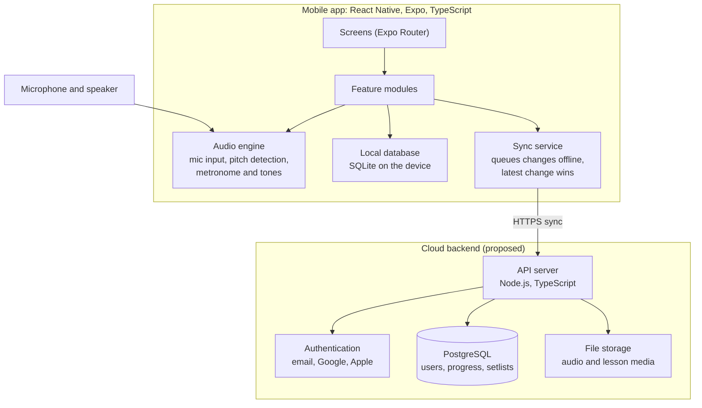
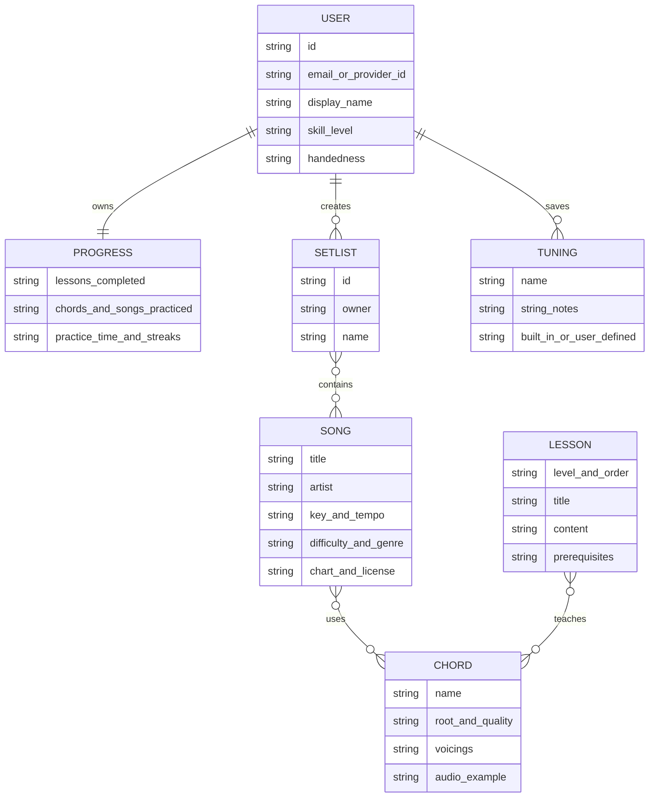
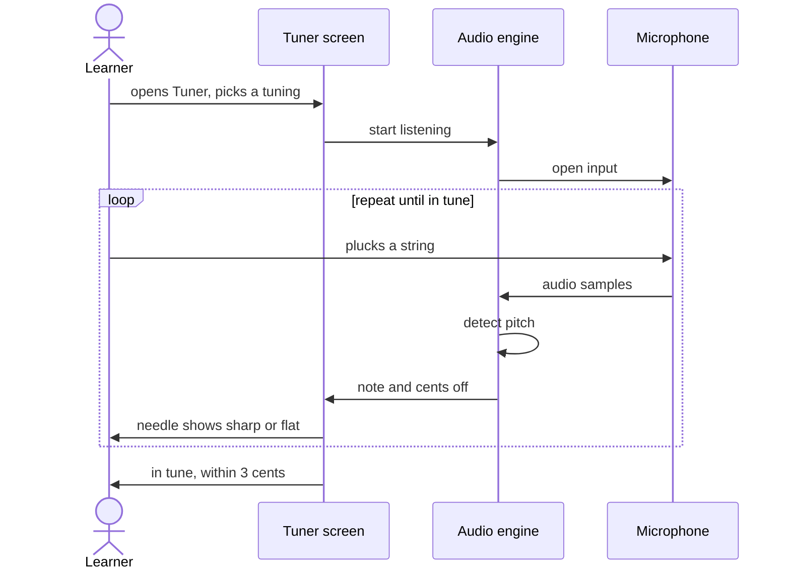
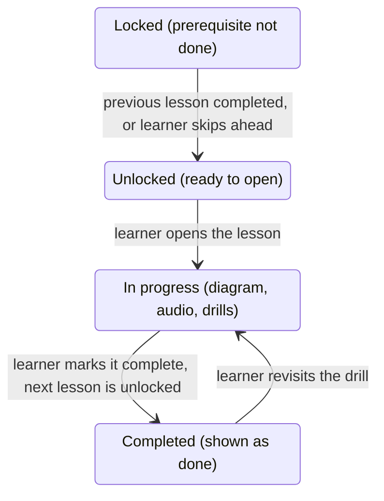

# Software Requirements Specification: Fretly

Product name: Fretly  
Prepared by: Victor  
Version: 0.1 (draft)  
Date: October 16, 2026

## 1. Introduction

### 1.1 Purpose
This document specifies the requirements for a cross-platform mobile application that teaches guitar. It covers step-by-step chord learning, an instrument tuner, and play-along practice of well-known songs. It is intended for the developer(s), testers, and any stakeholders who need to agree on what the first release must do.

### 1.2 Scope
Fretly runs on iOS and Android from a single codebase. It serves complete beginners, intermediate players refining their technique, and experienced players who want to play songs. The first release (MVP) includes all three core features: chord lessons, the tuner, and the song library.

In scope: chord lessons, tuner, song player, practice tools (metronome, progress tracking), user accounts and sync.

Out of scope for v1: video lessons from live instructors, social or community features, marketplace for user-created content, support for instruments other than guitar, and desktop or web clients.

### 1.3 Definitions and abbreviations
- Chord diagram: a graphic showing finger positions on the fretboard.
- Tab (tablature): a notation showing which string and fret to play.
- Capo: a clamp that raises the pitch of all strings.
- Cent: 1/100 of a semitone, used to measure tuning accuracy.
- Standard tuning: E2 A2 D3 G3 B3 E4 (low to high).
- MVP: minimum viable product, the first public release.
- SRS: Software Requirements Specification.

### 1.4 References
- IEEE Std 830-1998 and ISO/IEC/IEEE 29148, as structural guides for this document.
- Platform guidelines: Apple Human Interface Guidelines, Material Design.

### 1.5 Document overview
Section 2 describes the product in general terms. Section 3 lists the specific functional requirements. Section 4 covers interfaces, Section 5 non-functional requirements, Section 6 data, Section 7 release phasing, Section 8 risks, Section 9 open questions, Section 10 the technology stack, and Section 11 the structural and behavioral diagrams.

## 2. Overall Description

### 2.1 Product perspective
The app is a standalone, offline-first mobile product. It uses the phone microphone for tuning and optional listening feedback, and an optional cloud backend for accounts, sync, and the song catalog.

### 2.2 Product functions (summary)
1. Guided chord learning with diagrams, audio examples, and practice drills.
2. A chromatic and guitar-specific tuner with multiple tunings.
3. A song library with chord charts and tabs, auto-scrolling, tempo control, transposition, and capo support.
4. Practice tools: metronome, practice timer, streaks, and progress tracking.
5. Accounts with cloud sync across devices, plus a guest mode.

### 2.3 User classes and characteristics
- Beginner: has little or no music knowledge, needs plain-language guidance, small steps, and encouragement.
- Intermediate: knows open chords, is working on barre chords, strumming patterns, transitions, and speed.
- Advanced or professional: wants accurate tabs, transposition, setlists, alternate tunings, and fast access to material.

### 2.4 Operating environment
- iOS 15 or later, Android 8.0 (API 26) or later.
- Phones first; tablets supported with a responsive layout.
- Requires a microphone for the tuner. Works fully offline for downloaded content.

### 2.5 Design and implementation constraints
- A single cross-platform codebase built with React Native, Expo, and TypeScript (see Section 10).
- Audio processing must run on-device with low latency.
- Song content (lyrics, transcriptions, recordings) is copyrighted. The app must only include content that is licensed, original, or in the public domain (see Risks).
- App store policies of Apple and Google apply, including privacy disclosures and in-app purchase rules.

### 2.6 Assumptions and dependencies
- Users own or have access to an acoustic or electric guitar.
- The device microphone is adequate for pitch detection in a reasonably quiet room.
- A backend service is available for accounts and catalog updates, but the core app functions without it once content is downloaded.

## 3. Functional Requirements

Priority key: M = Must have (MVP), S = Should have, C = Could have (later release).

### 3.1 Onboarding and profile
- FR-ON-1 (M): The app shall ask the user for their skill level (beginner, intermediate, advanced) on first launch and use it to personalize the starting content.
- FR-ON-2 (M): The app shall ask whether the user is right-handed or left-handed and mirror all chord diagrams accordingly.
- FR-ON-3 (S): The app shall ask for the type of guitar (acoustic, electric, classical) and the user's goals (learn chords, play songs, improve technique).
- FR-ON-4 (M): The user shall be able to skip onboarding and change all answers later in settings.

### 3.2 Chord learning
- FR-CH-1 (M): The app shall provide a structured, step-by-step curriculum organized into levels, from first chords (for example Em, Am, E, A, D) through open chords, 7th chords, barre chords, and power chords.
- FR-CH-2 (M): Each lesson shall show a chord diagram, a plain-language description of finger placement, and an audio example of the chord played cleanly.
- FR-CH-3 (M): The app shall include a searchable chord library with at least the 12 root notes in major, minor, 7th, major 7th, minor 7th, sus2, sus4, and power chord forms, with multiple voicings where applicable.
- FR-CH-4 (M): The user shall be able to mark a lesson as complete, and the app shall unlock the next lesson when prerequisites are met. Advanced users shall be able to skip ahead.
- FR-CH-5 (M): The app shall provide chord-change drills in which the user practices switching between two or more chords against a metronome, with adjustable tempo.
- FR-CH-6 (S): The app shall listen through the microphone and tell the user whether the chord they played matches the target chord, and highlight which strings sound wrong where possible.
- FR-CH-7 (S): The app shall teach strumming patterns with a visual rhythm display and an audible count-in.
- FR-CH-8 (C): The app shall offer a chord finder where the user taps frets on a virtual fretboard and the app names the chord.

### 3.3 Tuner
- FR-TU-1 (M): The app shall detect the pitch of a plucked string using the device microphone and display the note name, the deviation in cents, and a visual needle or bar.
- FR-TU-2 (M): The tuner shall support standard tuning and at least these alternates: Drop D, half-step down, full-step down, DADGAD, and open G.
- FR-TU-3 (M): The tuner shall provide an automatic mode that identifies the nearest string and a manual mode where the user selects a specific string.
- FR-TU-4 (M): The tuner shall indicate that a string is in tune when it is within 3 cents of the target and shall give a clear visual and optional audio confirmation.
- FR-TU-5 (M): The tuner shall allow the reference pitch (A4) to be adjusted from 430 Hz to 450 Hz, defaulting to 440 Hz.
- FR-TU-6 (S): The app shall play a reference tone for each string so the user can tune by ear.
- FR-TU-7 (S): The tuner shall support custom tunings and let the user save them.
- FR-TU-8 (S): The tuner shall support a mode for bass guitar and ukulele as a future-proofing hook, without being a priority for v1.
- FR-TU-9 (M): The tuner shall work offline.

### 3.4 Song library and play-along
- FR-SG-1 (M): The app shall provide a catalog of songs, each with title, artist, difficulty rating (beginner, intermediate, advanced), chords used, tempo, and key.
- FR-SG-2 (M): Users shall be able to browse and search songs by title, artist, difficulty, chord set, and genre, and filter for songs playable with the chords they already know.
- FR-SG-3 (M): Each song shall display its chords above the lyrics or in a chord chart, with chord diagrams available on tap.
- FR-SG-4 (M): The song view shall auto-scroll at a user-adjustable speed and shall support a built-in metronome and count-in.
- FR-SG-5 (M): The app shall support transposition to any key and capo position, and show the resulting chord shapes.
- FR-SG-6 (M): Users shall be able to set tempo from 50% to 120% of the original and loop a selected section.
- FR-SG-7 (S): Where licensed audio or backing tracks are available, the app shall play them in sync with the scrolling chart, with a chord-highlighting cursor.
- FR-SG-8 (S): Advanced users shall be able to view tablature or standard notation for songs where it is available.
- FR-SG-9 (S): Users shall be able to favorite songs, create setlists, and reorder them.
- FR-SG-10 (S): The app shall estimate how accurately the user played along using microphone input and give feedback after the song.
- FR-SG-11 (C): Users shall be able to import their own chord sheets or tabs (text or supported file formats) for private use.
- FR-SG-12 (M): Songs shall be downloadable for offline use, and the app shall show download size and status.

### 3.5 Practice tools and progress
- FR-PR-1 (M): The app shall include a metronome with adjustable tempo from 30 to 240 BPM, time signature selection, and accent on the first beat.
- FR-PR-2 (M): The app shall record practice time per day and show a streak counter.
- FR-PR-3 (M): The app shall track completed lessons, chords learned, and songs practiced, and show progress on a dashboard.
- FR-PR-4 (S): The user shall be able to set a daily practice goal and receive an optional reminder notification.
- FR-PR-5 (S): The app shall recommend the next lesson or song based on the user's progress and level.
- FR-PR-6 (C): The app shall include ear training exercises such as identifying notes, intervals, and chord qualities.

### 3.6 Accounts and sync
- FR-AC-1 (M): The app shall allow use as a guest without creating an account.
- FR-AC-2 (M): The app shall support sign-up and sign-in with email and password, and with Google and Apple sign-in.
- FR-AC-3 (M): For signed-in users, progress, favorites, setlists, and settings shall sync across devices.
- FR-AC-4 (M): When offline, changes shall be stored locally and synced automatically when connectivity returns, with a defined rule for resolving conflicts (latest change wins per item).
- FR-AC-5 (M): Users shall be able to delete their account and all associated data from within the app.

### 3.7 Settings
- FR-SE-1 (M): The user shall be able to change handedness, skill level, notation preferences (chord diagrams or tabs), theme (light, dark, system), and language.
- FR-SE-2 (S): The user shall be able to manage downloads and clear cached content.
- FR-SE-3 (S): The user shall be able to control notification settings and microphone-related features.

### 3.8 Monetization (to be decided)
- FR-MO-1 (S): The app shall support a free tier and a paid subscription or one-time unlock, using the platform billing systems.
- FR-MO-2 (S): The free tier should include the tuner, basic chord lessons, and a limited set of songs.

## 4. External Interface Requirements

### 4.1 User interface
- The UI shall follow platform conventions on each OS while keeping a consistent brand style.
- Chord diagrams and song charts shall be legible on a 5-inch screen and support landscape orientation for song play-along.
- The tuner screen shall be usable at arm's length, with large text and a high-contrast display.
- The UI shall support dark mode, which is common during practice sessions.

### 4.2 Hardware interfaces
- Microphone: used for the tuner and listening feedback. The app shall request permission with a clear explanation, and shall remain usable if permission is denied (except for tuner and listening features).
- Speaker and headphones: used for reference tones, metronome, and backing tracks.
- Optional: external audio interface or clip-on tuner input via headset jack or USB, as a later enhancement.

### 4.3 Software interfaces
- Backend API (REST or GraphQL over HTTPS) for authentication, sync, and catalog updates.
- Platform billing (Apple App Store and Google Play Billing).
- Push notification services (APNs and Firebase Cloud Messaging).
- Optional analytics and crash reporting service, with user consent.

### 4.4 Communications interfaces
- All network traffic shall use HTTPS (TLS 1.2 or higher).
- The app shall minimize data use, support resumable downloads, and work on slow connections.

## 5. Non-Functional Requirements

### 5.1 Performance
- NFR-PE-1: The tuner shall display a pitch reading within 100 ms of a string being plucked.
- NFR-PE-2: Pitch detection shall be accurate to within plus or minus 2 cents under quiet conditions on supported devices.
- NFR-PE-3: The app shall cold start in under 3 seconds on a mid-range phone released within the last four years.
- NFR-PE-4: Song auto-scroll and metronome timing shall not drift or stutter, with metronome jitter under 10 ms.
- NFR-PE-5: The app shall not noticeably drain the battery; a 30-minute practice session should use no more than 10% of battery on a mid-range device.

### 5.2 Usability
- NFR-US-1: A new user shall be able to tune a guitar within one minute of first launch without instructions.
- NFR-US-2: Beginners shall be able to complete the first chord lesson within 10 minutes of finishing onboarding.
- NFR-US-3: The app shall use plain language and avoid music jargon in beginner content, with a glossary for terms.

### 5.3 Reliability and availability
- NFR-RE-1: Core features (tuner, metronome, downloaded lessons and songs) shall work with no network connection.
- NFR-RE-2: The crash-free session rate shall be at least 99.5%.
- NFR-RE-3: No user progress shall be lost during app updates, device restarts, or sync failures.

### 5.4 Security and privacy
- NFR-SP-1: Passwords shall be stored only as salted hashes on the server, and authentication tokens stored in the platform secure storage.
- NFR-SP-2: Audio from the microphone shall be processed on the device and shall not be recorded or uploaded unless the user explicitly opts in.
- NFR-SP-3: The app shall collect only the minimum personal data needed, publish a privacy policy, and comply with applicable data protection laws such as GDPR and Uganda's Data Protection and Privacy Act.
- NFR-SP-4: Users shall be able to export and delete their data.

### 5.5 Compatibility and portability
- NFR-CO-1: The app shall support at least 95% of active Android devices and 95% of active iPhones at launch.
- NFR-CO-2: At least 90% of the code shall be shared between iOS and Android.

### 5.6 Accessibility
- NFR-AC-1: The app shall support screen readers, scalable text, and sufficient colour contrast (WCAG 2.1 AA).
- NFR-AC-2: Tuning feedback shall not rely on colour alone; it shall also use shape, text, or sound.

### 5.7 Localization
- NFR-LO-1: The app shall launch in English, with all strings externalized so other languages can be added.
- NFR-LO-2: The app shall support both letter note names (C D E) and solfege (Do Re Mi).

### 5.8 Maintainability
- NFR-MA-1: Lesson and song content shall be stored as data, not code, so it can be updated without an app release.
- NFR-MA-2: The codebase shall have automated unit tests for audio and music-theory logic, and a CI pipeline that builds both platforms.

## 6. Data Requirements

Main entities:
- User: id, email or provider id, display name, skill level, handedness, preferences, created date.
- Chord: id, name, root, quality, voicings (frets per string, fingers, barre info), audio file reference.
- Lesson: id, level, order, title, content, prerequisites, associated chords.
- Song: id, title, artist, key, tempo, difficulty, genre, chart or tab data, license information, audio reference.
- Setlist: id, user, name, ordered list of songs.
- Progress: user, lessons completed, chords learned, songs practiced, practice time per day, streaks.
- Tuning: id, name, string notes, whether it is built in or user-defined.

Data retention: user data is kept while the account exists and deleted within 30 days of an account deletion request.

## 7. Release Plan

The MVP contains all three core features, as decided. To keep the first release achievable, build and test in this order within the MVP:

1. Foundation: project setup, navigation, onboarding, settings, local storage.
2. Tuner and metronome: the audio core and the quickest feature to validate.
3. Chord library and lessons: diagrams, audio examples, curriculum, drills.
4. Song library: chord charts, auto-scroll, transposition, capo, offline downloads.
5. Accounts, sync, and progress tracking.
6. Polish, accessibility, performance tuning, beta testing, store submission.

Later releases (Should and Could items): listening feedback for chords and songs, licensed backing tracks, tablature view, user imports, ear training, additional instruments and languages.

## 8. Risks

- Song licensing: lyrics, chord transcriptions, and recordings of famous songs are generally copyrighted. Mitigation: license content through a provider, use public-domain songs and original arrangements at launch, and let users import their own material privately.
- Pitch detection accuracy: noisy rooms, cheap microphones, and polyphonic chords make detection harder. Mitigation: test on a range of devices, tune the algorithm, and offer manual mode and reference tones.
- Audio latency differences between devices, especially on Android. Mitigation: use native audio modules and test on low-end devices early.
- Scope: three major features in the MVP is a lot for a small team. Mitigation: ship the Must items first, keep Should items behind clear milestones, and cut scope rather than quality.
- Content production effort: creating lessons, audio examples, and diagrams takes time. Mitigation: generate diagrams from data and record a small set of high-quality examples.

## 9. Open Questions

1. Which pitch-detection library or native audio module will be used, and does it require a development build instead of Expo Go?
2. What is the monetization model (free with ads, subscription, one-time purchase, or freemium)?
3. Which songs will be in the launch catalog, and how will they be licensed?
4. Will there be a backend built by you, or a managed service such as Firebase or Supabase?
5. What is the target launch date and team size?
6. Which languages and regions should be supported at launch?

## 10. Technology Stack

Fretly is built as one TypeScript codebase on React Native and Expo, developed in Visual Studio Code. Rows marked Decided are fixed; rows marked Proposed are recommendations to confirm during design.

| Layer | Choice | Status |
| --- | --- | --- |
| Mobile framework | React Native with Expo | Decided |
| Language | TypeScript | Decided |
| Editor | Visual Studio Code with Expo Tools, ESLint and Prettier | Decided |
| Development testing | Expo Go at first, then development builds for native audio | Proposed |
| Navigation | Expo Router | Proposed |
| Audio input and pitch detection | A native audio module (for example react-native-audio-api) with the YIN or McLeod pitch algorithm | Proposed, to be proven by a tuner prototype |
| Audio playback | expo-audio for chord examples, tones and the metronome | Proposed |
| Local storage | SQLite through expo-sqlite | Proposed |
| Backend API | Node.js with TypeScript | Proposed |
| Database | PostgreSQL | Proposed |
| Authentication | Email, Google and Apple sign-in | Proposed |
| Builds and releases | Expo Application Services (EAS) | Proposed |
| Testing and CI | Jest for unit tests, GitHub Actions for builds | Proposed |

## 11. System Models

Four diagrams describe Fretly: two structural views of what it is made of, and two behavioral views of what it does over time.

### 11.1 Structural view: system architecture

Learners get the tuner, lessons and downloaded songs from the phone alone; the sync service only talks to the backend for accounts, progress and content updates.

### 11.2 Structural view: data model

A user has one progress record and creates many setlists and custom tunings; setlists and songs, songs and chords, and lessons and chords are many-to-many.

### 11.3 Behavioral view: tuner sequence

Each pluck produces a new reading, and the screen confirms the string only when the pitch is within 3 cents of the target (FR-TU-4).

### 11.4 Behavioral view: lesson states

A lesson opens once its prerequisite is done or the learner skips ahead (FR-CH-4), and a completed lesson can be reopened for more drills.

## Appendix A: Sample Use Cases

UC-1 Tune the guitar
- Actor: any user. Precondition: microphone permission granted.
- Main flow: the user opens the Tuner, plucks a string, the app shows the detected note and deviation, the user adjusts the peg until the in-tune indicator appears, and repeats for each string.
- Alternative flow: the user selects Drop D, and the app updates the target notes.

UC-2 Learn a new chord
- Actor: beginner. Main flow: the user opens the next lesson, views the diagram and listens to the example, practices the shape, completes a chord-change drill with the metronome, and marks the lesson complete, which unlocks the next one.

UC-3 Play a song
- Actor: intermediate user. Main flow: the user filters for songs using chords they already know, opens a song, sets the capo and tempo, starts the count-in, and follows the auto-scrolling chart. Afterward the song is added to their practice history.
